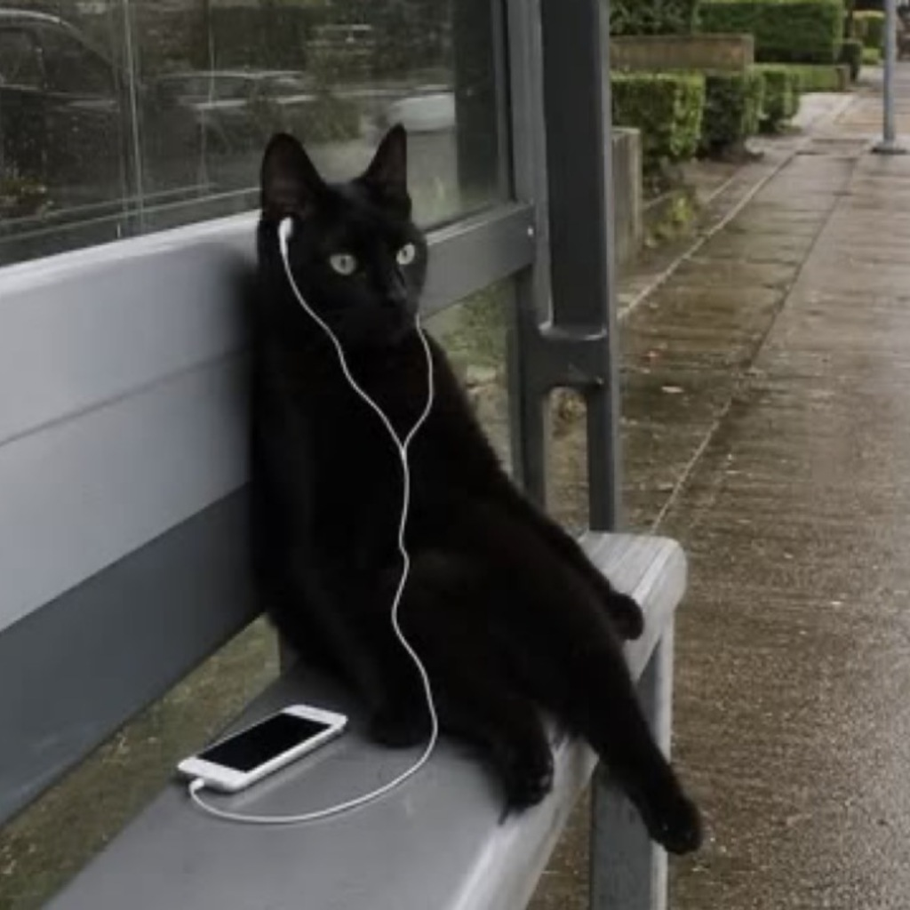
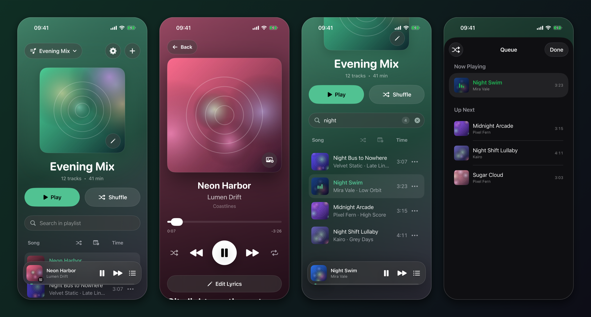

<p align="center">
  
</p>

# Offline Music

Бесплатный плеер для iPhone, чтобы слушать свою музыку без интернета. Загрузили файлы один раз, и дальше всё играет с телефона: без подписки, без рекламы, без стриминга.

**Полностью бесплатно.** Без подписок, рекламы и регистрации. Открытый код (лицензия MIT).



## Что умеет

- **Играет ваши файлы.** MP3, M4A, AAC, WAV, FLAC и другие форматы, которые понимает iPhone. Название, исполнитель, альбом и обложка берутся из самого файла.
- **Плейлисты.** Можно создавать, переименовывать и удалять плейлисты, ставить им обложку, сортировать «сначала новые» или один раз перемешать порядок.
- **Поиск, который управляет очередью.** Найдите треки в плейлисте и нажмите на любой: дальше сыграет выдача поиска сверху вниз в том порядке, как вы её видите. Когда выдача закончится, музыка продолжится с места в плейлисте, где стоит последний найденный трек.
- **Честное перемешивание.** Пока не прозвучат все треки плейлиста, ни один не повторится, даже если закрыть и снова открыть приложение. Песни одного исполнителя разносятся по очереди, а не идут подряд. Режим перемешивания и повтора запоминается.
- **Продолжает с того же места.** После перезапуска плеер помнит трек, позицию и очередь.
- **Экран воспроизведения.** Большая обложка, перемотка, кнопки перемешивания и повтора, текст песни. Цвета берутся из обложки.
- **Тексты и обложки.** Текст песни и обложку трека можно добавить или поменять прямо в приложении.
- **Очередь.** Видно, что сейчас играет и что будет дальше. Любой трек из очереди можно включить, убрать смахиванием или перемешать всю очередь.
- **Экран блокировки и наушники.** Управление с экрана блокировки, из Пункта управления и кнопками наушников, игра в фоне.
- **Резервные копии.** Вся библиотека выгружается в обычную папку: аудио, обложки, тексты и плейлисты. Из такой папки её можно восстановить на любом iPhone.
- **ChatGPT (по желанию).** Можно подключить ChatGPT через MCP, чтобы он создавал альбомы, добавлял треки, обложки и тексты. Удалять альбомы ChatGPT не может.

## Как устроено перемешивание

Обычное перемешивание (алгоритм Фишера — Йетса) честное для одного прохода, но приложение каждый раз начинает его заново. Если слушать по десять песен в день, одни треки выпадают снова и снова, а до других очередь не доходит. Spotify столкнулся с тем же и в 2025 году сделал режим «Fewer Repeats», который учитывает уже прослушанное.

Offline Music запоминает, какие треки уже звучали в текущем круге. Сначала идут те, что ещё не играли, и только когда прозвучат все, начинается новый круг. Внутри круга порядок случайный, а песни одного исполнителя разносятся по очереди [так же, как у Spotify](https://engineering.atspotify.com/2014/02/how-to-shuffle-songs). Тесты проверяют, что за 100 коротких сессий каждый трек из 300 играет одинаковое число раз, плюс-минус один.

## Установка

Приложения нет в App Store, его ставят на iPhone через Xcode:

1. Установите [Xcode](https://apps.apple.com/app/xcode/id497799835) 16 или новее и [XcodeGen](https://github.com/yonaskolb/XcodeGen) (`brew install xcodegen`).
2. Скачайте код и создайте проект:
   ```sh
   git clone https://github.com/lev67j/Offline-Music-App.git
   cd Offline-Music-App
   xcodegen generate
   open OfflineMusic.xcodeproj
   ```
3. В настройках цели OfflineMusic → Signing & Capabilities выберите свою команду (подойдёт бесплатный Apple ID), подключите iPhone и нажмите Run.

Нужен iOS 17 или новее.

## Где лежат файлы

Всё хранится на телефоне в папке приложения `Application Support/OfflineMusic`: аудио в `Audio`, обложки в `Covers`, библиотека в `library.json`. Рядом лежат несколько последних резервных копий библиотеки. Если основной файл повредится, приложение само восстановит последнюю целую копию.

Выгрузка всей библиотеки выглядит так:

```text
Offline Music Export 2026-10-24 12-30-00/
├── manifest.json
├── Playlist Covers/
└── Tracks/
    └── <id трека>/
        ├── audio.m4a
        ├── cover.jpg
        ├── lyrics.txt
        └── metadata.json
```

## Сборка и тесты

```sh
xcodegen generate
xcodebuild -project OfflineMusic.xcodeproj -scheme OfflineMusic \
  -destination 'platform=iOS Simulator,name=iPhone 17 Pro' test
```

UI-тесты играют демо-библиотеку: перед запуском её кладёт в симулятор `scripts/seed-simulator.sh`. Сервер для синхронизации и ChatGPT лежит в `backend` (FastAPI):

```sh
python3 -m venv .venv
.venv/bin/pip install -r backend/requirements.txt
PYTHONPATH=backend .venv/bin/pytest backend/tests -q
```

## Безопасность

Ключи и пароли сервера в репозитории не хранятся: их передаёт среда запуска. Токен устройства лежит в связке ключей iOS. Об уязвимостях пишите через GitHub Security Advisories, подробнее в [SECURITY.md](SECURITY.md).
